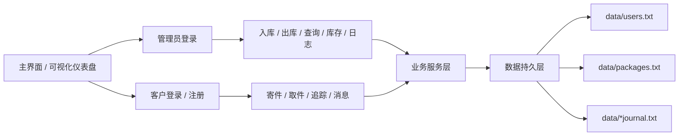

# 菜鸟驿站智能快递管理系统

一个用 **纯 C 语言** 编写的控制台可视化快递驿站管理系统，不依赖任何第三方库，适合作为 C 语言课程设计与简历项目。


---

## 项目亮点

- **纯 C 实现**：只使用 C 标准库与 Windows 系统控制台 API，零第三方依赖。
- **控制台可视化**：带边框、颜色、统计面板、数据表格、物流轨迹图的可视化页面，告别枯燥的纯文本输入输出。
- **模块化架构**：数据模型、持久层、UI、认证、用户端、管理端分层，结构清晰，便于阅读和维护。
- **文本化持久层**：使用 `data/` 下的文本文件保存用户、包裹、日志，数据可读、可备份，避免二进制结构体对齐问题。
- **健壮输入处理**：统一封装字符串、整数、浮点数读取，支持输入校验和缓冲区清理。
- **业务仿真**：启动时自动模拟“运输中 → 已到站”和“滞留超时”状态流转。

> 在线可视化展示页：[docs/index.html](docs/index.html)，打开即可查看项目功能、架构、账号与运行方式。

## 演示账号

| 角色 | 账号 | 密码 | 说明 |
| --- | --- | --- | --- |
| 管理员 1 | `0001` | `8888` | 入库、出库、查询、注销用户 |
| 管理员 2 | `0002` | `9999` | 同上 |
| 客户 | `zhangsan` | `123456` | 演示用户张三 |
| 客户 | `lisi` | `123456` | 演示用户李四 |
| 客户 | `wangwu` | `123456` | 演示用户王五 |

> 首次启动时如果 `data/` 目录不存在，系统会自动生成以上演示数据。

## 功能清单

### 用户端

- 账号注册、登录、注销（注销前校验是否存在未完成包裹）
- 寄件：收件人类型、重量、加急/标准、价值、省内/省外、保价
- 运费明细：基础运费、续重费、高价值加成、保价费
- 取件：凭 4 位取件码取件，支持本人取件与代取
- 包裹状态：待取件、运输中、已送达、超时滞留、已取件
- 包裹轨迹：下单 → 运输 → 到站 → 取件 的可视化时间线
- 站内消息：到站提醒、超时提醒、取件确认等通知

### 管理端

- 系统概览：用户数、包裹总数、待取件、运输中、超时、累计运费
- 包裹入库：自动建议唯一编号/取件码，校验收件人是否存在
- 包裹出库：按单号出库并同步用户消息
- 多条件查询：按用户、单号、运输方式、运输距离
- 库存列表与包裹详情
- 注销用户（级联清理该用户全部包裹）
- 操作日志查看

## 业务规则

| 场景 | 规则 |
| --- | --- |
| 标准 / 省内 | 首重 10 元，续重 2 元/kg |
| 标准 / 省外 | 首重 12 元，续重 5 元/kg |
| 加急 / 省内 | 首重 12 元，续重 2 元/kg |
| 加急 / 省外 | 首重 22 元，续重 8 元/kg |
| 高价值商品 | 价值 ≥ 1000 元，总运费 × 1.1 |
| 保价 | 保费 2 元；价值 ≥ 1000 元再加 (价值-1000) × 0.003 元 |
| 滞留超时 | 入库超过 3 天未取件，标记为超时滞留 |
| 运输送达 | 运输超过 3 天自动模拟送达，用户包裹进入待取件状态 |

## 架构设计



## 目录结构

```text
Cainiao-Station/
├─ main.c            # 自动生成的单文件版本，可直接编译运行
├─ src/
│  ├─ main.c        # 程序入口与主仪表盘
│  ├─ model.h/.c    # 数据结构、链表操作、业务状态机
│  ├─ data.h/.c     # 文本持久化与演示数据
│  ├─ ui.h/.c       # 控制台可视化组件与输入封装
│  ├─ auth.h/.c     # 登录、注册、注销
│  ├─ user.h/.c     # 用户端业务
│  └─ manager.h/.c  # 管理端业务
├─ CainiaoStation.sln
├─ CainiaoStation.vcxproj
├─ data/            # 运行时自动生成
├─ legacy_replaced/ # 旧版文件备份，不参与编译
├─ tools/
│  └─ build_single_file.py  # 由 src/ 重新生成 main.c
├─ .vscode/         # VS Code 一键编译运行配置
├─ build.bat        # Windows 一键编译
├─ run.bat          # Windows 编译并运行
├─ Makefile         # GCC / MinGW 构建
└─ README.md
```

> `legacy_replaced/` 中保留的是你替换下来的旧版文件（含 `快递驿站.cpp` 等），仅作备份，不参与最终编译。最终可运行、可提交的代码全部在 `src/`，且保持纯 C 语言实现。

根目录的 `main.c` 是由 `src/` 自动合并生成的单文件版本，内容与模块化源码完全一致。修改 `src/` 后，运行下面命令即可重新生成：

```bash
python tools/build_single_file.py
```

## 编译与运行

### 方式一：Visual Studio 2022（推荐）

1. 直接打开项目根目录下的 `CainiaoStation.sln`。
2. 按 `Ctrl + F5` 或 `F5` 编译运行。

工程已配置为纯 C11 编译、`/utf-8` 源码编码，并自动将可执行文件输出到 `build/`。

### 方式二：VS Code

1. 用 VS Code 打开项目根目录。
2. 打开 `main.c`，按 `F5` 运行。

项目已提供 `.vscode/tasks.json` 和 `launch.json`，会自动调用 `cl` 或 `gcc` 编译 `main.c`。

### 方式三：Windows 命令行

```bat
build.bat
run.bat
```

### 方式四：GCC / MinGW

```bash
make
make run
```

也可以直接编译单文件版本：

```bash
gcc -std=c11 -O2 main.c -o CainiaoStation
./CainiaoStation
```

### 方式五：项目自带便携编译器（当前仓库已配置）

项目根目录的 `tools/zig/` 中已放入便携 Zig 编译器（该目录已加入 `.gitignore`，不会上传到 GitHub）。直接双击 `run.bat`，或打开 VS Code 按 `F5`，即可使用本地 Zig 编译并运行，无需安装 Visual Studio 或 MinGW。

## 数据结构说明

用户与包裹均使用单链表组织，是典型的指针与动态内存练习：

- `User`：用户信息、消息环形缓冲区、名下包裹链表
- `Package`：包裹编号、取件码、运费信息、状态数组、出入库时间
- `Manager`：管理员账号与密码

包裹状态由 4 个状态位表达：

| 状态位 | 含义 |
| --- | --- |
| `state[0]` | 在库 / 已出库 / 运输中 |
| `state[1]` | 完好 / 有损 |
| `state[2]` | 运输中 / 已送达 |
| `state[3]` | 正常 / 超时滞留 |

## 项目定位

该项目可以直接用于简历中的 C 语言项目经历，面试时可以重点讲：

1. 链表、结构体、动态内存管理在业务中的实际运用。
2. 文本文件持久化如何避免二进制序列化的平台兼容问题。
3. 控制台 UI 层的封装如何提升用户体验。
4. 业务状态机（运输、到站、超时、取件）如何被拆分和测试。
