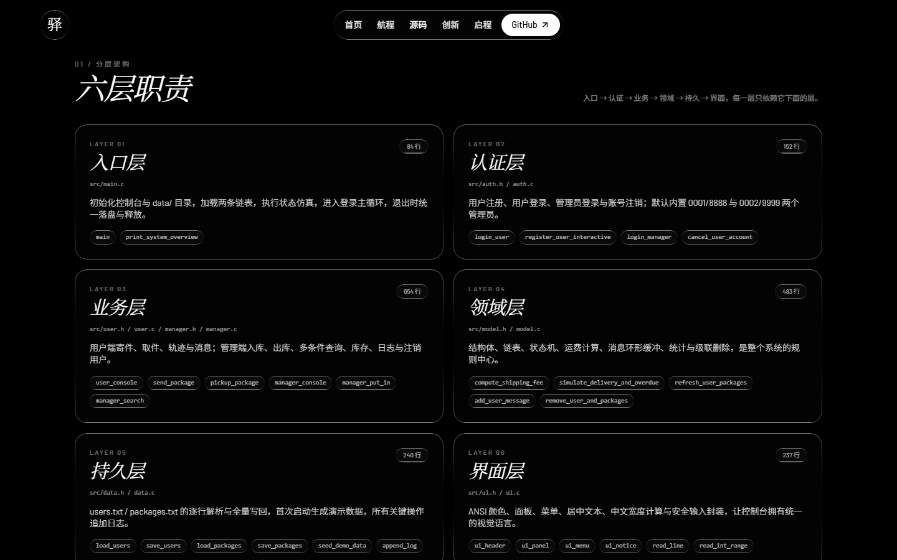
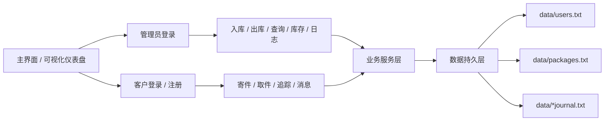

# 菜鸟驿站智能快递管理系统

基于 C11 与 Windows 控制台 API 实现的菜鸟驿站快递管理控制台系统，覆盖用户寄件、取件、包裹追踪，以及管理员入库、出库、查询、库存与操作日志等核心流程。C 语言部分不依赖任何第三方库，数据以文本文件持久化，支持 Windows / Linux 编译运行；项目官网前端依赖已全部本地化。

   


## 项目简介

- **纯 C 实现**：只使用 C 标准库与 Windows 控制台 API，无第三方依赖。
- **控制台可视化**：提供边框、颜色、统计面板、数据表格与物流轨迹时间线。
- **模块化分层**：入口、认证、业务、领域、持久化、界面六层分离。
- **文本化持久层**：用户、包裹与日志写入 `data/` 下的可读文本文件，便于迁移与备份。
- **业务仿真**：启动时按入库天数自动推进运输、到站与超时状态。
- **项目官网**：根目录 `index.html` 提供完整项目展示，前端资源已全部本地化，可离线运行。

| 指标 | 说明 |
| --- | --- |
| 开发语言 | C11 |
| 运行平台 | Windows 10/11、Linux |
| 第三方依赖 | C 语言部分无；前端依赖已本地化 |
| 源码规模 | 7 个 `.c` 文件、6 个头文件，约 1,880 行 |
| 数据存储 | `data/` 目录下的文本文件 |
| 前端站点 | React 18 + Tailwind CSS + Framer Motion，单页应用 |

## 界面预览

| 核心能力 | 航程 |
| --- | --- |
|  |  |

| 源码结构 | 六层职责 |
| --- | --- |
|  |  |

<p align="center">
  
  &nbsp;&nbsp;
  
</p>

## 功能清单

### 用户端

- 账号注册、登录、注销；注销前校验是否存在运输中或待取件包裹。
- 寄件：收件人、重量、标准/加急、省内/省外、保价与价值录入。
- 运费明细：基础运费、续重费、高价值加成与保价费。
- 取件：凭 4 位取件码取件，支持本人取件与代取。
- 包裹状态：待取件、运输中、已送达、超时滞留、已取件。
- 包裹轨迹：下单 → 运输 → 到站 → 取件的可视化时间线。
- 站内消息：到站提醒、超时提醒、取件确认等通知。

### 管理端

- 系统概览：用户数、包裹总数、待取件、运输中、超时与累计运费。
- 包裹入库：自动生成唯一单号与取件码，校验收件人。
- 包裹出库：按单号出库并同步用户消息。
- 多条件查询：按用户、单号、运输方式、运输距离筛选。
- 库存列表与包裹详情。
- 注销用户：级联清理该用户名下全部包裹。
- 操作日志：系统、用户、管理员三类日志。

## 演示账号

| 角色 | 账号 | 密码 | 说明 |
| --- | --- | --- | --- |
| 管理员 | `0001` | `8888` | 入库、出库、查询、注销用户 |
| 管理员 | `0002` | `9999` | 同上 |
| 客户 | `zhangsan` | `123456` | 演示用户张三 |
| 客户 | `lisi` | `123456` | 演示用户李四 |
| 客户 | `wangwu` | `123456` | 演示用户王五 |

首次启动时，如果 `data/` 不存在或两个数据文件均为空，系统会自动生成以上演示数据。

## 业务规则

### 运费规则

| 场景 | 首重（1kg） | 续重（元/kg） |
| --- | --- | --- |
| 标准 / 省内 | 10 元 | 2 元 |
| 标准 / 省外 | 12 元 | 5 元 |
| 加急 / 省内 | 12 元 | 2 元 |
| 加急 / 省外 | 22 元 | 8 元 |

- 包裹价值 ≥ 1000 元时，总运费 × 1.1。
- 保价费 2 元；价值 ≥ 1000 元时，额外收取 `(价值 - 1000) × 0.003` 元。

### 状态规则

| 场景 | 规则 |
| --- | --- |
| 运输送达 | 运输超过 3 天自动送达：用户包裹转为待取件，非用户包裹自动签收 |
| 超时滞留 | 入库超过 3 天未取件，标记为超时滞留 |
| 超时提醒 | 入库第 2–3 天向用户发送即将超时提醒 |
| 注销限制 | 存在运输中或待取件包裹时，不允许注销账号 |

## 架构设计



| 层级 | 源文件 | 职责 |
| --- | --- | --- |
| 入口层 | `src/main.c` | 初始化、加载数据、状态仿真、登录主循环、退出落盘 |
| 认证层 | `src/auth.c` | 用户注册/登录、管理员登录、账号注销 |
| 业务层 | `src/user.c`、`src/manager.c` | 用户端与管理端控制台业务 |
| 领域层 | `src/model.h`、`src/model.c` | 结构体、链表、状态机、运费、消息与统计 |
| 持久层 | `src/data.c` | 文本文件读写、演示数据、操作日志 |
| 界面层 | `src/ui.h`、`src/ui.c` | ANSI 颜色、面板、菜单、输入校验与宽度计算 |

## 目录结构

```text
Cainiao-Station/
├─ index.html                 # 项目官网入口（离线单页应用）
├─ vendor/                    # Tailwind、React、ReactDOM、Babel、Framer Motion
├─ fonts/                     # 本地字体与 woff2 子集
├─ assets/
│  └─ videos/                 # 项目官网背景视频
├─ main.c                     # 由 src/ 自动合并生成
├─ src/
│  ├─ main.c                  # 程序入口与主仪表盘
│  ├─ model.h/.c              # 数据结构、链表、状态机与业务规则
│  ├─ data.h/.c               # 文本持久化与演示数据
│  ├─ ui.h/.c                 # 控制台可视化组件与输入封装
│  ├─ auth.h/.c               # 登录、注册、注销
│  ├─ user.h/.c               # 用户端业务
│  └─ manager.h/.c            # 管理端业务
├─ data/                      # 运行时生成，已加入 .gitignore
├─ docs/
│  ├─ index.html              # 旧版静态展示页
│  ├─ badges/                 # README 本地徽章
│  └─ screenshots/            # README 界面预览图
├─ legacy_replaced/           # 旧版文件备份，不参与编译
├─ tools/
│  ├─ build_single_file.py    # 由 src/ 重新生成根目录 main.c
│  └─ zig/                    # 本地便携编译器，已加入 .gitignore
├─ CainiaoStation.sln         # Visual Studio 2022 工程
├─ CainiaoStation.vcxproj
├─ build.bat                  # Windows 一键编译
├─ run.bat                    # Windows 编译并运行
├─ Makefile                   # GCC / MinGW 构建
└─ README.md
```

## 项目官网

项目官网位于根目录 [index.html](index.html)，使用单页应用形式组织项目内容，可作为项目说明、源码导读与演示入口。

### 页面

| 路由 | 页面 | 内容 |
| --- | --- | --- |
| `#/` | 首页 | 项目定位、核心数据、能力概览 |
| `#/voyages` | 航程 | 寄件、运输、到站、取件四段流程 |
| `#/source` | 源码 | 六层架构、目录结构、启动时序、核心结构、状态机、持久化与调用链 |
| `#/innovation` | 创新 | 纯 C11、状态机、文本持久化 |
| `#/launch` | 启程 | 三步启动流程与演示账号 |

### 技术栈

| 组件 | 说明 |
| --- | --- |
| React 18.3.1 UMD | 页面组件与状态管理 |
| Babel Standalone 7.29.0 | 浏览器内 JSX 编译 |
| Framer Motion 11.11.17 | 入场动画与交互过渡 |
| Tailwind CSS | 原子化样式与响应式布局 |
| 原生 CSS | 液态玻璃、视频层与动画细节 |

### 本地资源与离线运行

- 所有前端依赖位于 `vendor/`，字体位于 `fonts/`，视频位于 `assets/videos/`。
- 页面运行时不发起任何外部请求；仅 GitHub 按钮为外部跳转链接。
- 前端运行资源约 37 MB，无构建步骤，直接打开 `index.html` 即可运行。

```bash
# 可选：通过本地 HTTP 服务预览
python -m http.server 8765
# 浏览器访问 http://127.0.0.1:8765/index.html
```

## 编译与运行

### 方式一：Visual Studio 2022

1. 打开根目录 `CainiaoStation.sln`。
2. 按 `Ctrl + F5` 或 `F5` 编译运行。

工程已配置为 C11 编译、`/utf-8` 源码编码，可执行文件输出至 `build/`。

### 方式二：VS Code

1. 使用 VS Code 打开项目根目录。
2. 打开 `main.c`，按 `F5` 运行。

项目已提供 `.vscode/tasks.json` 与 `launch.json`，会自动调用 `cl` 或 `gcc`。

### 方式三：Windows 命令行

```bat
build.bat
run.bat
```

### 方式四：GCC / MinGW

```bash
make
make run
```

也可以直接编译单文件版本：

```bash
gcc -std=c11 -O2 main.c -o CainiaoStation
./CainiaoStation
```

### 方式五：项目自带便携编译器

项目目录中的 `tools/zig/` 为本地便携 Zig 编译器，已加入 `.gitignore`，不会上传至 GitHub。配置后可直接双击 `run.bat`，或在 VS Code 中按 `F5`，无需安装 Visual Studio 或 MinGW。

### 单文件版本

根目录 `main.c` 由 `src/` 自动合并生成，与模块化源码保持同源：

```bash
python tools/build_single_file.py
```

## 数据结构说明

用户与包裹均使用单链表组织，便于演示指针操作与动态内存管理。

- `User`：用户信息、消息环形缓冲区、名下包裹链表。
- `Package`：包裹编号、取件码、计费字段、4 个状态位、出入库时间与运费。
- `Manager`：管理员账号、密码与链表指针。
- `Message`：消息内容与时间戳，每个用户最多保留 30 条，写满后覆盖最旧消息。

包裹状态由 4 个状态位表达：

| 状态位 | 含义 |
| --- | --- |
| `state[0]` | 在库 / 已取件 / 运输中 |
| `state[1]` | 完好 / 有损 |
| `state[2]` | 运输中 / 已送达 |
| `state[3]` | 正常 / 超时滞留 |

用户视角的包裹链表是全局包裹链表的克隆视图，由 `refresh_user_packages()` 统一重建，避免同一份包裹数据被重复释放。

## 项目定位

该项目可作为 C 语言课程设计、毕业设计或求职项目展示，重点体现以下工程能力：

1. 链表、结构体与动态内存管理在业务系统中的实际应用。
2. 文本文件持久化与跨平台兼容性设计。
3. 控制台 UI 封装与输入校验对交互体验的提升。
4. 业务状态机（运输、到站、超时、取件）的拆分与实现。
5. 模块化源码与单文件版本的同源构建流程。

## 第三方资源

- 前端依赖已本地化至 `vendor/`：React、ReactDOM、Babel Standalone、Framer Motion、Tailwind CSS，遵循各自的开源许可。
- 字体位于 `fonts/`：Instrument Serif、Barlow、Noto Sans SC、Noto Serif SC，遵循 SIL Open Font License 1.1。
- 背景视频位于 `assets/videos/`，页面运行时不发起外部请求。
- C 语言部分仅使用 C 标准库与 Windows 控制台 API，无第三方依赖。
